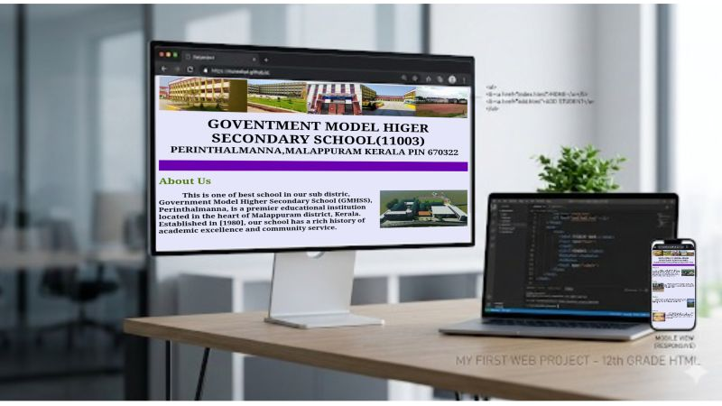
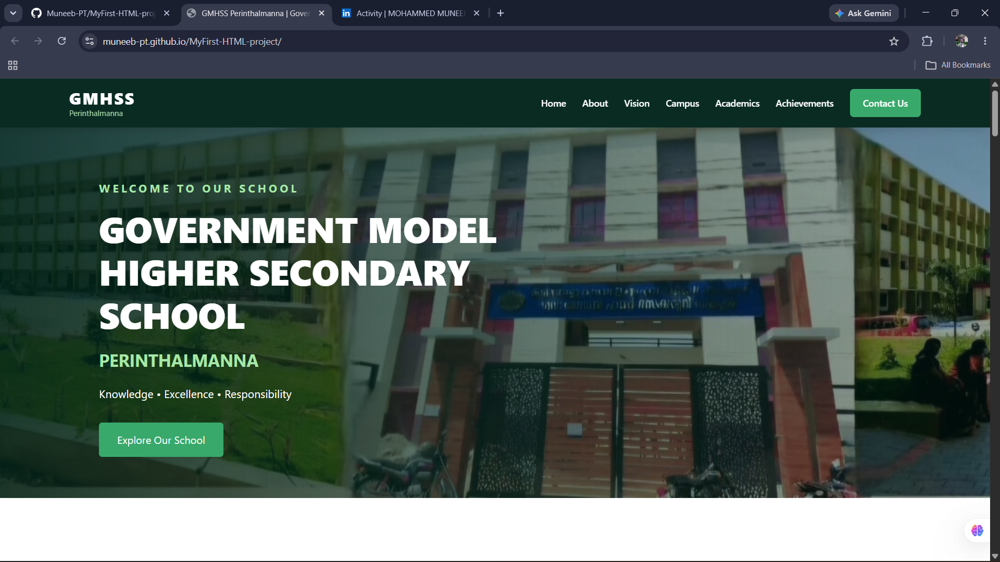
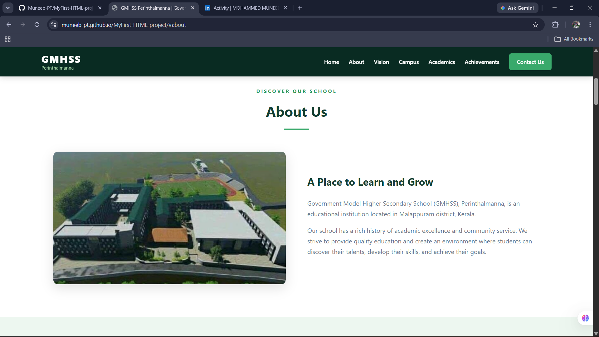
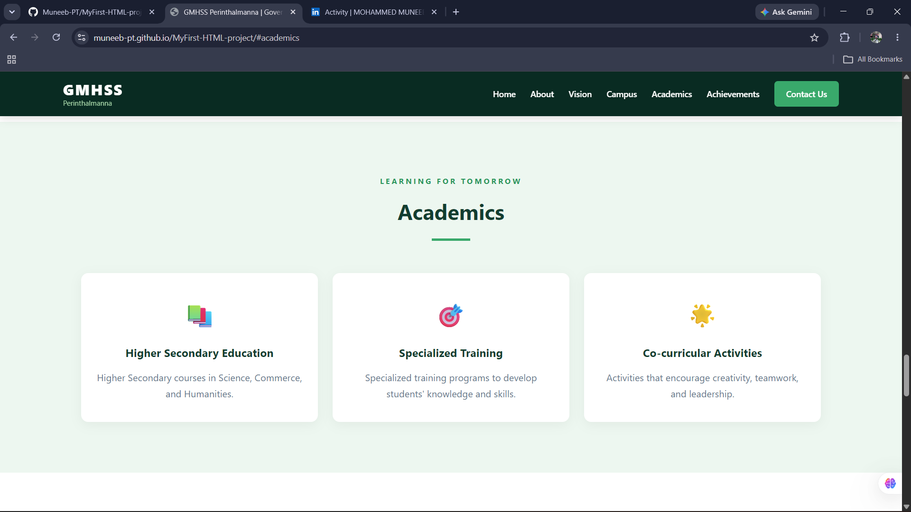
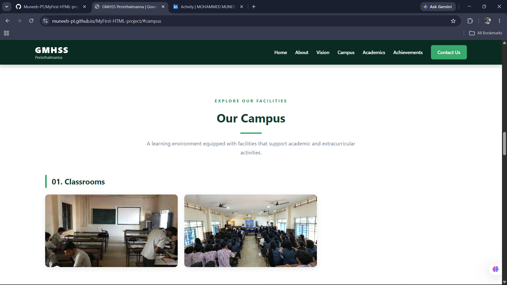
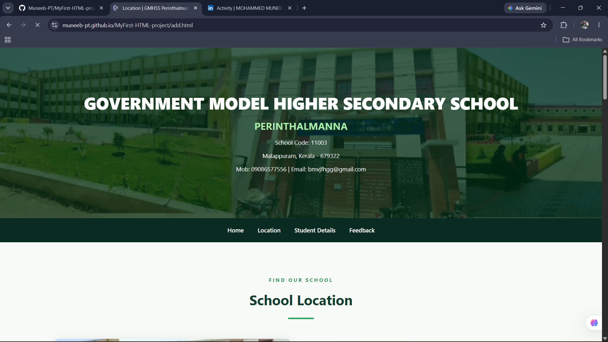
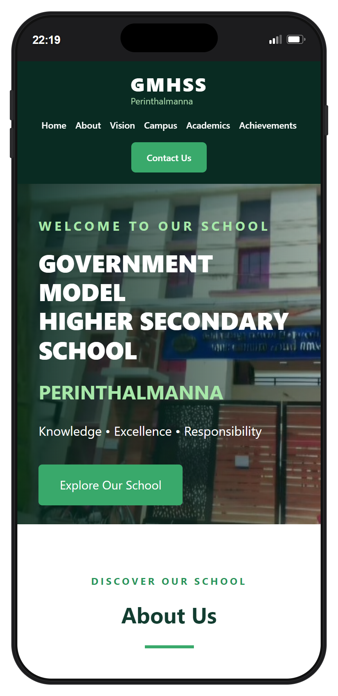

# GMHSS PMNA — School Website

### From my first HTML experiment to a redesigned school website.

[](https://muneeb-pt.github.io/MyFirst-HTML-project/)
[](https://developer.mozilla.org/en-US/docs/Web/HTML)
[](https://developer.mozilla.org/en-US/docs/Web/CSS)

**Live Website:** https://muneeb-pt.github.io/MyFirst-HTML-project/

---

## 📖 The Story Behind This Project

This project started as one of my first experiments with web development during my Class 12 studies.

At that time, I was just beginning to understand how websites worked. I started with basic HTML, experimenting with elements, images, links, tables and page structures. It was not a professional website, but it was an important starting point in my journey.

Later, after starting my B.Tech in Computer Science and Engineering, I decided to revisit this old project.

Instead of leaving it as a simple beginner-level website, I wanted to see how much I could improve it with the knowledge and tools I had gained.

I redesigned the website, introduced CSS styling, improved the layout and navigation, organized the content into meaningful sections and worked on making the website more responsive.

I also used AI as a development assistant to speed up parts of the process. However, the project became an opportunity to explore the generated code, understand how different elements work together, identify issues and make improvements.

**The most interesting part of this project is not just the final website. It is the progress between the first version and the redesigned version.**

---

## 🔄 Website Evolution: Before & After

This section showcases the transformation of the project from its original beginner version to the redesigned website.

### 1. Before — Original Version

My first version, created while learning basic HTML.



### 2. After — Redesigned Version

The redesigned website with improved structure, styling, navigation and content presentation.



### 3. More Screenshots

#### About the School


#### Academics


#### Campus and Facilities


#### Location and Student Details


#### Responsive Design


---

## ✨ Features

- School introduction and overview.
- About, vision, mission and history sections.
- Campus and facilities gallery.
- Academic information.
- Achievements section.
- Community information.
- Contact and location information.
- Student details and course distribution.
- Responsive layouts for different screen sizes.

*Note: The feedback form is currently a frontend interface. It requires backend or form-service integration to receive and store submissions.*

---

## 🛠️ Technologies Used

| Technology | Purpose |
|---|---|
| HTML5 | Website structure and content |
| CSS3 | Styling, layouts and responsive design |
| Git | Version control |
| GitHub | Source code hosting |
| GitHub Pages | Website deployment |
| AI Tools | Development assistance and learning support |

---

## 📂 Project Structure

```text
MyFirst-HTML-project/
│
├── index.html
├── style.css
│
├── add.html
├── add.css
│
├── screenshots/
│   ├── old-homepage.png
│   ├── new-homepage.png
│   ├── about-section.png
│   ├── academics-section.png
│   ├── campus-section.png
│   ├── location-page.png
│   └── mobile-view.png
│
├── README.md
│
└── images and other assets
```

---

## 📚 What I Learned

Working on this project helped me explore and practise:

- Structuring webpages using HTML.
- Using semantic HTML elements.
- Connecting external CSS files.
- Working with images, links, tables and navigation.
- Understanding CSS layouts and positioning.
- Using Flexbox and responsive design techniques.
- Organizing a website into multiple pages and sections.
- Hosting a website using GitHub Pages.
- Using GitHub to maintain and showcase projects.
- Debugging and improving existing code.
- Using AI tools as development assistance.

---

## 🤖 My Experience Using AI

AI played a role in accelerating the redesign process.

It helped me explore design ideas, generate code suggestions and understand possible solutions. But this also made me realize something important:

**Generating code is not the same as understanding code.**

My next goal is to become more confident in writing, modifying and debugging the code independently, rather than depending on AI for every change.

I consider this project a learning milestone, not a finished demonstration of my web development skills.

---

## 🚀 Future Improvements

Some improvements I would like to explore:

- JavaScript-based interactive features.
- A functional feedback form.
- Better accessibility.
- Improved image optimization and loading performance.
- More advanced mobile navigation.
- A dynamic school notice board.
- Further UI and UX improvements.

---

## 👨‍💻 About Me

**Mohammed Muneeb PT**

B.Tech Computer Science and Engineering Student

Interested in Software Engineering, Artificial Intelligence and Machine Learning, and Web Development.

- GitHub: [Muneeb-PT](https://github.com/Muneeb-PT)
- LinkedIn: [Mohammed Muneeb PT](https://www.linkedin.com/in/mohammed-muneeb-pt/)

---

## ⭐ Final Note

This repository represents more than a school website.

It represents a small part of my journey from writing my first HTML code to revisiting, redesigning and improving an existing project.

There is still a lot to learn, and this is only the beginning.

**Built while learning. Improved with curiosity. Still evolving.**
